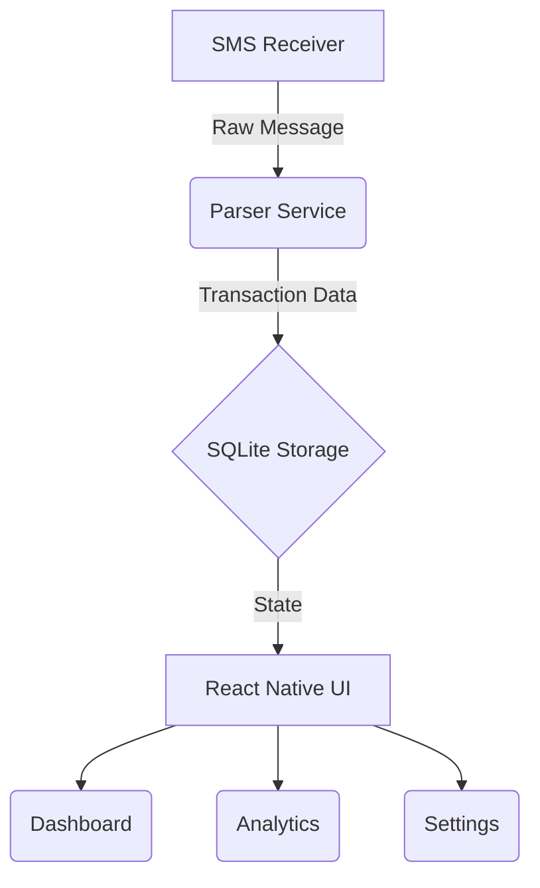

<div align="center">
  
  
  # 🏦 Hisab
  
  **Your Personal Finance & Balance Tracking Companion**
  
  
  
  

  <p align="center">
    <i>Secure, private, and automated financial tracking based on SMS notifications.</i>
  </p>
</div>

---

## 📥 Download

**Hisab is free to download as an Android APK, built and signed automatically from GitHub Releases.**

<p align="center">
  <a href="https://github.com/dan-seng/balance-tracker/releases/latest/download/Hisab.apk">
    
  </a>
  <a href="https://dan-seng.github.io/balance-tracker/">
    
  </a>
</p>

- Install the APK and allow **"install from unknown sources"** when prompted — expected for direct Android downloads.
- All releases are listed at: [github.com/dan-seng/balance-tracker/releases](https://github.com/dan-seng/balance-tracker/releases)

---

## ✨ Features

- **Automated Tracking**: Extracts transaction data from SMS messages sent by your bank.
- **100% Offline & Private**: All parsing, processing, and storage happens locally on your device. No cloud sync, no internet required.
- **Biometric Security**: Keep your financial data safe with native biometric authentication and customizable auto-lock timeouts.
- **Multi-Bank Support**: Works seamlessly with multiple banks. Easily add custom banks and SMS sender rules.
- **Beautiful UI**: Modern, sleek, dark-themed interface built with a premium touch.
- **Detailed Analytics**: Visualize your spending habits and account balances over time.
- **Shop Ledger**: Record products, opening stock, restocks, multi-item sales, running expenses, customer credit, and repayments. See daily/monthly profit, collections, and outstanding balances. Shop records stay in a separate local database and survive SMS resyncs.

---

## 📸 Screenshots

*(Add screenshots of your beautiful UI here)*
> E.g., Dashboard, Lock Screen, Analytics, Settings.

---

## 🚀 Getting Started

### Prerequisites

- Node.js `^22.11.0`
- React Native CLI
- Android Studio & SDK (for Android development)

### Installation

1. **Clone the repository:**
   ```sh
   git clone <repository_url>
   cd HisabApp
   ```

2. **Install dependencies:**
   ```sh
   npm install
   ```

3. **Start the Metro Bundler:**
   ```sh
   npm start
   ```

4. **Run the Application:**
   Open a new terminal window and run:
   ```sh
   npm run android
   ```
   *(iOS support requires CocoaPods and Xcode setup)*

---

## 🛠️ Tech Stack

- **Framework**: [React Native](https://reactnative.dev)
- **Language**: [TypeScript](https://www.typescriptlang.org/)
- **Database**: `react-native-sqlite-storage`
- **Security**: `react-native-biometrics`
- **Styling**: `react-native-linear-gradient` & `react-native-svg`

### Shop ledger checks

Run `npx jest __tests__/shopUtils.test.ts __tests__/shopDatabase.test.ts __tests__/ShopScreen.test.tsx --runInBand`. The database integration test uses Python 3's built-in SQLite to execute the real queries while replacing only the Android bridge.

The first Shop version records whole units (pieces, packs, bottles, etc.) and ETB amounts with two decimal places. Profit uses sale-time product costs and recorded operating expenses. Collections include repayments; outstanding customer debt is always shown across all time.

---

## 🏗️ Project Architecture



### Key Modules

- **`/src/db`**: Local SQLite database setup, queries, and migrations.
- **`/src/parsers`**: Logic for parsing bank SMS formats into structured `Transaction` models.
- **`/src/screens`**: React components representing the app's views.
- **`/src/models`**: TypeScript interfaces defining the core data structures (e.g., `Account`, `Transaction`).

---

## 🛡️ Privacy & Permissions

This app requires the following permissions to function:
- `READ_SMS` & `RECEIVE_SMS`: Necessary to automatically track incoming bank transactions. 
*(No SMS data ever leaves your device).*

---

## 🛣️ Roadmap

- [x] Basic UI screens (Dashboard, Bank Detail)
- [x] SMS Integration & Local Storage
- [x] Automated parsing and balance calculation
- [x] Biometric lock implementation
- [ ] iOS Support (SMS parsing via alternative means if possible)
- [ ] Export to CSV/PDF
- [ ] Budgeting and categorization

---

<div align="center">
  <i>Built with ❤️ using React Native</i>
</div>

### Languages

Choose **English** or **አማርኛ** in **Settings → Language**. The entire interface, including Shop, switches immediately and remembers your choice offline. See [language support](docs/languages.md) for coverage and translation maintenance.
