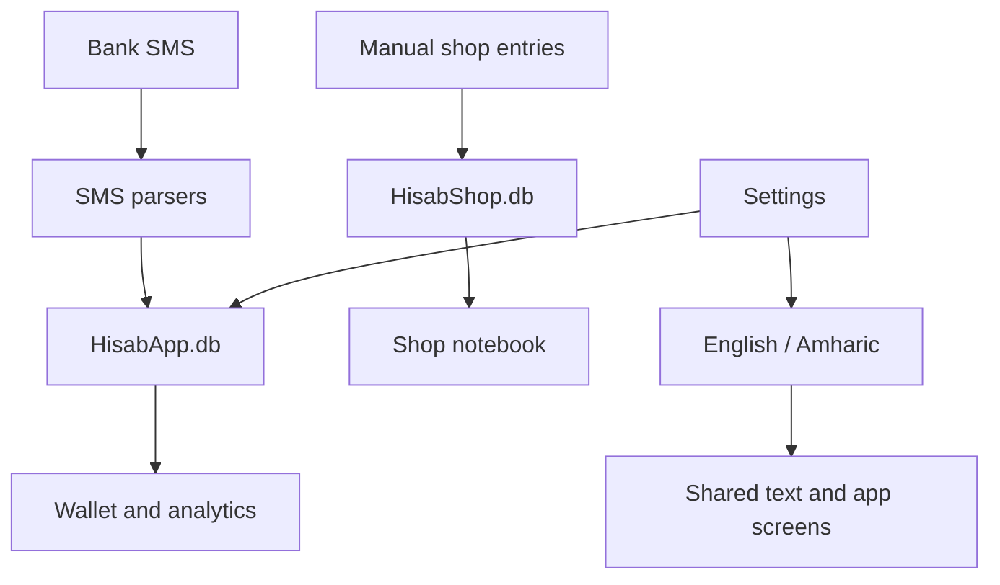

<div align="center">
  

  # Hisab · ሂሳብ

  **Bank balances and a simple shop notebook, on your phone.**

  
  
  
</div>

Hisab is an Android app for tracking Ethiopian bank accounts from SMS and keeping manual shop records in ETB. Messages and financial records are processed and stored locally, with no cloud sync.

## Download

[Download the latest Android APK](https://github.com/dan-seng/balance-tracker/releases/latest/download/Hisab.apk) · [All releases](https://github.com/dan-seng/balance-tracker/releases) · [Download page](https://dan-seng.github.io/balance-tracker/)

Allow installation from your browser or file manager if Android requests it. The repository's GitHub Actions release workflow builds and signs the APK.

## Features

- **Wallet:** bank SMS import, individual account balances, combined balance, income and spending totals, and balance visibility controls.
- **Bank accounts:** multiple accounts, custom bank names and SMS sender IDs, transaction history, search and filters.
- **Transaction reasons:** add or edit a personal reason for recent bank transactions in Analytics. Reasons survive SMS reimports and are included in encrypted backups.
- **Analytics:** calendar reports for Monday–Sunday weeks, complete months and January–December years, with previous/next period navigation, categories and top merchants inferred from bank messages.
- **Shop:** products, quantities, stock purchases, sales, expenses, profit, customer debt and debt payments, returns, stock corrections, shareable daily/customer reports, and supplier credit.
- **English and Amharic:** switch in Settings; your choice is remembered offline. Amharic uses the bundled Nokia Pure font.
- **Backup and restore:** password-protected `.hisab` files, record previews and optional safety copies before replacement.
- **Security:** biometric app lock and configurable automatic locking.

## Using Shop

Open **Shop** from the bottom navigation. The **How to use Shop** guide explains the workflow in either language.

1. **Add a product.** Enter its name, how you count it, the quantity already on your shelf, and the buying and selling prices for one item.
2. **Record a sale.** Choose the items and quantities, then enter what the customer paid. Leave the payment field blank for full payment, or enter `0` if nothing was paid. Select a customer whenever money is still owed.
3. **Buy stock.** Record additional items purchased for resale. This increases stock and updates the average buying price.
4. **Add an expense.** Record shop running costs such as rent, transport, wages or bills.
5. **Record a debt payment.** Open Customers, choose the customer and unpaid sale, then enter their payment.

**Daily totals** shows profit or loss, money received, and what customers owe. You can select today, this month or all time.

| Total | What it means |
| --- | --- |
| Profit / loss | Sales minus the purchase cost of the items sold and shop expenses. Includes sales customers have not paid for yet. |
| Money received | Sale payments and debt payments received in the selected period. |
| Customers owe | All unpaid customer sales, regardless of the selected period. |

For example, buying an item for **100 ETB** and selling it for **150 ETB** earns **50 ETB** before shop expenses. If the customer pays later, the sale still contributes to profit; their later payment increases money received without counting the sale twice.

Stock purchases reduce profit as the items sell. Record them through **Buy stock** to avoid also counting them as running expenses. Quantities use whole numbers; ETB amounts support two decimal places.

Shop has its own SQLite database, works without SMS permission, and survives bank SMS resyncs. Shop records are entered manually and are not automatically matched to bank transactions. See [Shop documentation](docs/shop-feature.md).

### More shop tools

Open **Shop → More shop tools** to record full or partial returns, correct stock counts with a reason, share a daily closing summary or customer statement, and track suppliers, stock purchases on credit and later payments. Returns automatically reduce unpaid customer balances and calculate any cash refund. Only saleable returns go back into stock; missing or damaged shelf stock is recorded as a loss.

## Language settings

Go to **Settings → Language** and choose **English** or **አማርኛ**. Navigation, onboarding, wallet, analytics, settings and Shop update immediately, and the selection is restored after reopening.

Names, account numbers and original SMS contents stay as entered or received. Dates and amounts follow the selected language; this does not switch to the Ethiopian calendar. Android-owned permission dialogs follow the device language. See [language support](docs/languages.md) for implementation and translation maintenance.

## Backup and restore

Open **Settings → Backup & restore** to create an encrypted file or restore one. Save it to your phone or an installed storage provider. You need the file and its password to restore. Restoration replaces existing bank and Shop records; the preview offers a safety backup first. See [backup documentation](docs/backup.md).

## Development

### Requirements

- Node.js **22.11.0 or newer**
- Android Studio, Android SDK and a compatible Java environment
- An Android device or emulator
- Python 3 for the SQLite integration tests

### Run locally

```sh
git clone https://github.com/dan-seng/balance-tracker.git
cd balance-tracker
npm install
npm start
```

In another terminal:

```sh
npm run android
```

The Android build includes ARM phone and Intel emulator architectures. To build a debug APK specifically for an x86_64 emulator:

```sh
cd android
./gradlew app:assembleDebug -PreactNativeArchitectures=x86_64
```

Bank imports require real bank SMS and SMS permissions. You can use Shop on an emulator without bank messages.

### Checks

```sh
npx tsc --noEmit
npm test -- --runInBand
npm run lint
```

The current test suite has **55 tests** covering shop accounting and SQLite persistence, partial payments, sale drafts, first-product setup, language switching, preference restoration and save failures. The database integration tests execute real SQLite queries using Python 3 while replacing the Android bridge.

Android emulator checks also verified startup, persisted Amharic selection, Nokia Pure rendering and the Shop guide. TypeScript, all tests and lint for changed files passed; the full-repository lint command may report existing issues in other files.

## Architecture



| Module | Responsibility |
| --- | --- |
| `src/screens` | Wallet, analytics, Shop, settings, onboarding and lock screens |
| `src/components` | Shared controls, bank cards, transaction sheets and text rendering |
| `src/db` | Local SQLite storage for bank data, settings and Shop records |
| `src/parsers` | Bank SMS parsing into account and transaction data |
| `src/i18n` | Language selection and Amharic translations |
| `src/utils` | Balances, spending insights and shop accounting |
| `src/models` | Typed account, transaction and shop records |

Built with React Native, TypeScript, `react-native-sqlite-storage`, `react-native-biometrics`, `react-native-svg` and `react-native-linear-gradient`.

## Privacy and permissions

`READ_SMS` and `RECEIVE_SMS` enable bank-message imports and incoming transaction tracking. SMS data is processed locally. Manual encrypted backups include the original SMS text and are saved only to the location you choose. **Shop does not need these permissions.**

## Future work

CSV/PDF export, fractional quantities, taxes and multi-shop support are not implemented in the current Shop version. iOS support would require a different approach to bank-message imports.
